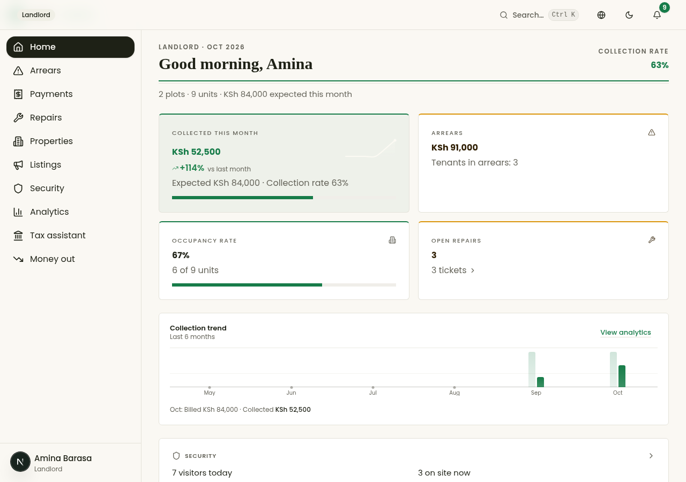
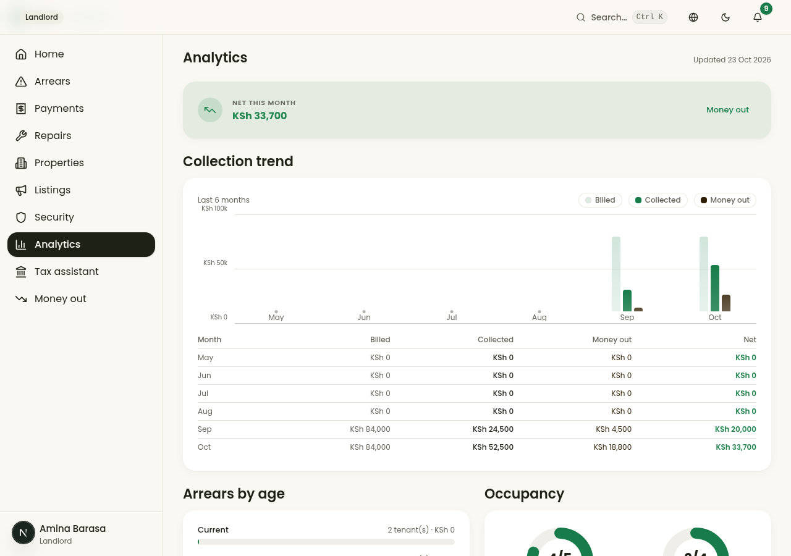
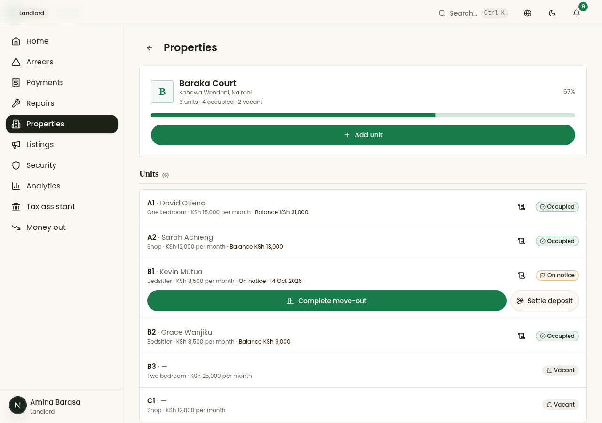
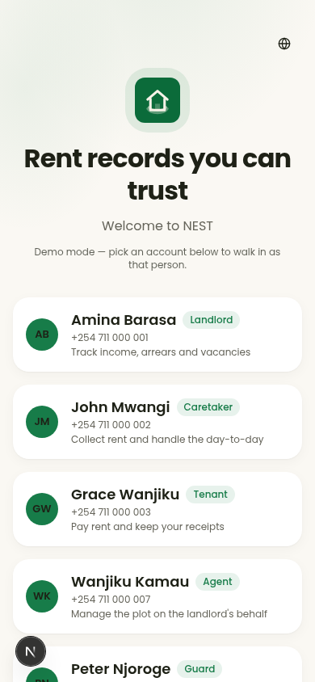
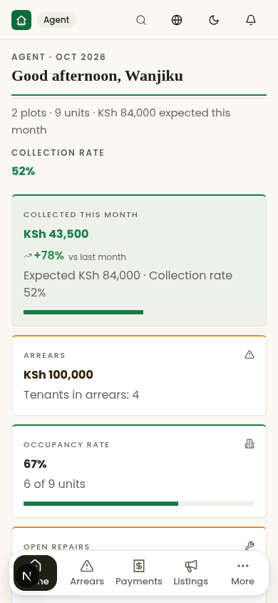
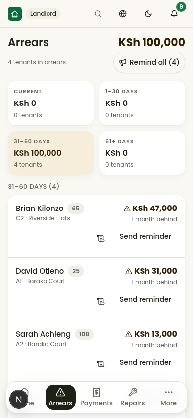

<div align="center">


# NEST

**The rental operating system for Kenya.**
One plot. Five roles. One record of truth.

[](https://github.com/captainEdins/nest/actions/workflows/ci.yml)
[](LICENSE)
[](docs/architecture/overview.md)

*Rent in Kenya runs on trust between people who rarely meet. NEST turns every verbal claim into a timestamped, verifiable record — and never plays judge.*

</div>

---

## 📊 For investors — the one-pager

**The problem.** A typical Kenyan rental plot involves a landlord (often in another city), an agent appointed to run the plot on their behalf, a caretaker collecting cash, tenants who want receipts, and a guard at the gate. Rent is tracked in exercise books and WhatsApp messages. Arrears are invisible until they're large. Deposits vanish in disputes. The caretaker — the person who actually runs the plot — is the least tooled and the most accused.

**The wedge.** *Caretaker + M-Pesa: "who has paid, and can they prove it?"* NEST starts at the exact moment money changes hands: STK Push and C2B rent collection, an automatic reconciliation engine that matches every payment to tenant, unit and charge, and instant shareable receipts. Cash collections by caretakers are recorded in under 3 taps — with a receipt that protects *them* as much as the landlord.

**The moat.** Parity features (M-Pesa reconciliation, SMS/WhatsApp reminders) are table stakes. NEST differentiates on data no one else accumulates in one place: payment history, repair trails, move-in condition reports, an append-only deposit ledger, and plot reputation — across **all five roles**, not just landlord-and-tenant. That record underwrites the Phase 4+ products: rent scores for lenders (tenants *and* landlords), rent advances via partner financiers, and embedded insurance.

**The tailwind.** KRA's eRITS platform and the draft Residential Rental Income Tax Regulations are pushing landlords toward digital, audit-ready records. Monthly Rental Income tax (7.5% of gross residential rent) is filed monthly by the 20th. Compliance becomes a feature, not a chore. *(NEST's tax tooling is record-keeping assistance, never tax advice — verified against final regulations before build.)*

**The honest risks.** A Kenyan fintech ("nesti") already operates in rent payments — brand clearance is tracked as a blocking issue; "NEST" is a codename until cleared. Incumbents ship broad suites; NEST wins by being field-first (offline, low-end Android, Kiswahili) and by making the caretaker the hero.

### What is shipped in this repo (Phase 0 → 7)

| Capability | Status |
|---|---|
| Five role-based home screens (landlord / agent / caretaker / tenant / guard) | ✅ shipped |
| **Agent parity (P23)** — the appointed agent gets the landlord's desk scoped to their plots: money KPIs + MoM, arrears with bulk reminders, payments with match, analytics, security digest, read-only expenses, staff statements. Tax (KRA) + money-out writes stay the owner's | ✅ shipped |
| **Honest front door + product gallery (P24)** — the demo login degrades visibly (tinted empty state + retry, EN/SW) when identities are unavailable instead of a silent blank; the README carries the product's own screenshots | ✅ shipped |
| Demo auth with role switching (Supabase phone-OTP adapter boundary) | ✅ shipped |
| M-Pesa **STK Push** + Daraja-format callbacks (simulated sandbox, live-ready boundary) | ✅ shipped |
| **Automatic reconciliation engine** — waterfall allocation, idempotent callbacks, unmatched-payment review queue | ✅ shipped |
| Instant receipts + shareable record; cash collections in ≤3 taps | ✅ shipped |
| Arrears with aging; occupancy & collection-rate KPIs | ✅ shipped |
| Append-only money ledger (integer KES minor units) + audit log on every financial action | ✅ shipped |
| **Maintenance tickets** — tenant reporting → caretaker queue → landlord view → resolution timeline | ✅ shipped |
| **Move-in condition reports** with per-room condition grading | ✅ shipped |
| **Deposit ledger** — append-only movements, landlord settlement flow, tenant deposit detail | ✅ shipped |
| **Guard module** — visitor gate register, incident reporting with acknowledgement, shift lifecycle | ✅ shipped |
| **Agent funnel** — listings → applicants → landlord approve/reject, append-only event timelines | ✅ shipped |
| **PWA** — installable, service worker (production registration), offline-tolerant collections | ✅ shipped |
| **Landlord analytics** — 6-month collection trend (CSS-first bar chart: real-text labels at every width, headroom by construction), arrears-by-age buckets, occupancy donuts (zero chart deps) | ✅ shipped |
| **KRA/MRI tax assistant** — monthly rent summary, 7.5% MRI estimate, CSV export (record-keeping only, never tax advice) | ✅ shipped |
| **Tenant monthly statement** — brought-forward → billed → settled → carried-forward per month; cross-month payments shown where they landed | ✅ shipped |
| **Rent Score (tenant + staff views)** — 0–800 from four documented factors, factor breakdown on the card, same engine output on arrears rows | ✅ shipped |
| **Notification Center** — read state per row, unread badge on the bell (every role), All/Unread filters, mark-one/mark-all read, translated headings for all 11 event types | ✅ shipped |
| **Move-in** — approved applicant → active tenancy in one transaction: tenant profile (find-or-create), deposit HELD with append-only movement, first rent charge raised, unit flips OCCUPIED, listing closes LET, CONVERTED timeline event, agent + tenant notified, audited | ✅ shipped |
| **Monty-inspired visual refresh + MoM deltas** — Soft-SaaS execution layer (2xl radius, layered shadows, pastel chips, segmented controls, floating bottom dock, login hero) and month-over-month KPI deltas computed server-side in the same overview call | ✅ shipped |
| **Lease exit arc** — notice to vacate (tenant or landlord) with move-out date + reason on the audit record, withdrawable before execution; move-out inspection sheet (the evidence the deposit settlement reads against); one-transaction move-out (tenancy ENDED, unit VACANT); settle action survives the exit (ENDED + deposit HELD rows stay reachable) | ✅ shipped |
| **Property drill-down (P26)** — tap a property card (home or Properties tab) to open THAT plot: its units with tenants (type · rent · balance · status), every exit-arc row action preserved, and an Add-unit flow (label/type/rent/deposit, LANDLORD-only `POST /api/units`, 409 on duplicate label, unit born VACANT, audited) — the flat all-plots unit list is retired | ✅ shipped |
| **Honest zeros & the detail layer (P27)** — all-zero chart months print a visible baseline dot instead of invisible slivers (both trend surfaces); hover/keyboard-focus shows an exact-values chip inside the plot; the analytics table breathes in a scrollable strip at ≤400px; every list row (arrears, payments, units, visitors) gains consistent hover tint + press feedback; bars get a subtle top-lighter gradient | ✅ shipped |
| English & Kiswahili, light/dark | ✅ shipped |
| Consent-gated external Rent Score API, financing & insurance partners, load/security hardening | 🗺 next tail (see [roadmap](#-roadmap)) |

### The product, in pictures

Every shot below is the real app, captured from the running release (no mockups — same tool and seed as the per-phase QA evidence in [docs/qa/](docs/qa/)):

<table>
  <tr>
    <td width="50%" valign="top" align="center">
      <a href="docs/shots/readme/landlord-home.png"></a><br>
      <sub><b>The landlord's desk</b> — classic ledger language (D-034): masthead, figure-box KPIs, one record of truth.</sub>
    </td>
    <td width="50%" valign="top" align="center">
      <a href="docs/shots/readme/analytics.png"></a><br>
      <sub><b>Analytics</b> — collection trend (CSS-first bars, D-038), aging, occupancy, and the P&L hero; zero chart deps.</sub>
    </td>
  </tr>
  <tr>
    <td colspan="2" valign="top" align="center">
      <a href="docs/shots/readme/property-detail.png"></a><br>
      <sub><b>Property drill-down (P26)</b> — tap a plot card to open ITS units with their tenants; add a unit from here (born vacant, audited).</sub>
    </td>
  </tr>
  <tr>
    <td valign="top" align="center">
      <a href="docs/shots/readme/login.png"></a>
    </td>
    <td valign="top" align="center">
      <a href="docs/shots/readme/agent-home.png"></a>
    </td>
    <td valign="top" align="center">
      <a href="docs/shots/readme/arrears.png"></a>
    </td>
  </tr>
  <tr>
    <td colspan="3" align="center">
      <sub><b>One plot, five roles</b> — sign in as anyone (left) · <b>Agent parity</b> (P23) — the appointed agent runs the landlord's desk, scoped (center) · <b>Arrears</b> — aging, rent scores, bulk reminders (right)</sub>
    </td>
  </tr>
</table>

### Business-model hooks (Phase 4+, by design)

- **Rent Score API** — consent-based scoring for partner lenders, underwritten on NEST's accumulated record.
- **Rent advance & landlord bridge financing** — via licensed partners; NEST never lends from its own balance sheet.
- **Embedded insurance** — tenant contents, landlord rent guarantee.
- Transaction take-rate on collections; SaaS per-unit pricing; white-label for property companies and SACCOs.

---

## 🛠️ For engineers & recruiters — how this is built

This repo was built as a **simulated engineering organization**, not a solo sprint: a Principal Engineer sets contracts (types, schema, API, design tokens), specialist agents build against them, and *different* specialists review the work. Nothing merges without a peer review and a QA pass. Every significant trade-off is a written [ADR](docs/adr/); every platform adaptation is recorded in [DECISIONS.md](DECISIONS.md).

### Architecture at a glance

```
┌──────────────────────────── Next.js 16 (App Router, TS strict) ───────────────────────────┐
│  /                     single app shell: role gate → role dashboard (mobile-first PWA)    │
│  src/components/nest   role dashboards · pay flows · receipts · arrears · review queue    │
│  src/lib/i18n          English + Kiswahili dictionaries, typed keys                      │
└───────────────┬───────────────────────────────────────────────────────────────────────────┘
                │ typed DTOs (src/lib/types.ts) — the contract seam
┌───────────────▼───────────────────────────────────────────────────────────────────────────┐
│  API layer (route handlers, Zod-validated, session-scoped)                                │
│  /api/auth /api/overview /api/payments/* /api/mpesa/callback /api/receipts /api/notify    │
└──────┬──────────────────────┬──────────────────────────────┬──────────────────────────────┘
       │                      │                              │
┌──────▼────────┐   ┌─────────▼──────────┐   ┌───────────────▼──────────────┐
│ Prisma domain │   │ M-Pesa Daraja      │   │ Reconciliation engine        │
│ (SQLite dev / │   │ boundary: STK Push │   │ match → waterfall allocate → │
│  Supabase in  │   │ + callbacks, HMAC  │   │ receipt → notify → audit     │
│  production)  │   │ verification,      │   │ (idempotent by checkout id)  │
│ append-only   │   │ idempotent replay- │   │ unmatched → manual review    │
│ money ledger  │   │ safe processing    │   │ queue                        │
└───────────────┘   └────────────────────┘   └──────────────────────────────┘
```

### Engineering discipline you can audit in this repo

- **Money is integer KES minor units, end to end.** No float ever touches a shilling. Receipts are derived from an auto-increment sequence — race-free by construction. ([money.ts](src/lib/money.ts), [ADR-0004](docs/adr/ADR-0004-append-only-ledger.md))
- **Append-only financial records.** Payments are never edited; failed pushes never create money rows; corrections are reversing entries. Every financial action writes an audit-log row.
- **Idempotent payment processing.** Replaying the same Daraja callback any number of times credits a tenant exactly once (verified behavior, not a claim).
- **Server-side role scoping on every route** — a role-scope matrix ([docs/architecture/role-scope-matrix.md](docs/architecture/role-scope-matrix.md)) defines who sees what; the client is never trusted. This maps 1:1 onto Supabase RLS policies for production.
- **Typed contract seam.** One `types.ts` is the source of truth for every API boundary — frontend, backend and tests all import it.
- **Quality gates per phase** (lint + typecheck zero errors, scripted E2E per role on mobile viewport, adversarial security probes: cross-role access, callback replay, append-only tampering) with evidence in [docs/qa/](docs/qa/).
- **Design system before screens.** Tokens, type scale (Poppins 400/500/600/700 — the only font), states and component rules are specified in [docs/design/](docs/design/), then implemented, then audited against spec.

### Run it locally

```bash
git clone https://github.com/captainEdins/nest.git && cd nest
bun install
cp .env.example .env        # fill SESSION_SECRET; Supabase/Daraja keys optional
bun run db:push             # create the SQLite schema
bun run db:seed             # demo plot: 5 roles, 3 tenancies, arrears + unmatched payment
bun run dev                 # http://localhost:3000
```

**Demo identities** (seeded — sign in as any role from the home screen):

| Role | Phone | What to try |
|---|---|---|
| 👑 Landlord — Amina Barasa | +254711000001 | KPIs, arrears aging **with rent-score chips**, match the unmatched payment, **Analytics charts, Tax assistant + CSV** |
| 🧰 Caretaker — John Mwangi | +254711000002 | Record a cash collection in 3 taps, request M-Pesa, repairs queue |
| 🏠 Tenant — Grace Wanjiku | +254711000003 | Pay rent via M-Pesa (sandbox sim), get instant receipt, report a repair, **see your Rent Score + monthly Statement (More tab)** |
| 🏠 Tenant — David Otieno | +254711000004 | See arrears balance + reminder |
| 🔒 Guard — Peter Njoroge | +254711000006 | Log a visitor, report an incident, start/end shift |
| 🤝 Agent — Wanjiku Kamau | +254711000007 | **Amina's appointed agent** — the landlord's desk scoped to both plots: money KPIs, **arrears + Remind all**, payments, **match an unmatched payment**, analytics, statement print — plus publish a listing, record applicants, run the pipeline |

> M-Pesa runs in `MPESA_MODE=sim` — a full Daraja-shaped sandbox (real STK callback JSON, real idempotency path) with the network call stubbed and clearly labelled. Set Daraja keys + `MPESA_MODE=live` to hit the real sandbox.

### Repository map

```
src/app/            Next.js App Router — single-shell route + API handlers
src/components/nest Role dashboards and flows (shadcn/ui primitives)
src/lib/            contracts (types, money), session, reconciliation, mpesa, i18n
prisma/             schema + seed (one demo plot, all five roles)
docs/               adr/ · architecture/ · design/ · guides/ (EN+SW) · qa/
.github/            issue templates · PR template · CODEOWNERS · CI workflow
DECISIONS.md        every assumption, trade-off and rejected alternative
```

---

## 🗺 Roadmap

| Phase | Scope | Status |
|---|---|---|
| 0 | Foundations: repo, contracts, design system, schema, CI | ✅ |
| 1 | **The wedge**: auth+roles, M-Pesa collection, reconciliation, receipts, arrears, dashboards | ✅ |
| 2 | Maintenance tickets, condition reports with photos, deposit ledger, KRA/MRI assistant | ✅ |
| 3 | Guard module (visitors, incidents, shifts), caretaker fraud detection (unmatched-payment review), offline hardening | ✅ |
| 4 | Agent module, listings funnel, landlord approvals, PWA service worker | ✅ |
| 5-wedge | Landlord analytics (trend/aging/occupancy), KRA/MRI assistant + CSV export, a11y polish | ✅ v0.5.0 |
| 6-wedge | **Tenant monthly statement** (portable payment record) + **Rent Score** (0–800, four documented factors, tenant card + staff chips) | ✅ v0.6.0 (this repo) |
| 7-wedge | **Notification Center** — read state (readAt), unread bell badges, All/Unread filters, mark-read, full template-heading coverage (11 keys, EN+SW) | ✅ v0.7.0 (this repo) |
| 8-wedge | **Move-in** — the funnel's closing transaction: approved applicant → active, money-ready tenancy (deposit HELD, first charge raised, unit OCCUPIED, listing LET, CONVERTED event, notifications, audit — all in one atomic POST /api/move-ins) | ✅ v0.8.0 (this repo) |
| 9-wedge | **Monty-inspired visual refresh** — Soft-SaaS execution layer on the dictated green brand (D-022): 2xl cards + layered shadows, pastel status chips, uppercase micro-label KPI cards with 28px tabular values + **server-computed month-over-month deltas** (`monthCollectedPrevMinor`, zero extra queries), Monty SegmentedControl, floating bottom dock, login hero, chart polish | ✅ v0.9.0 (this repo) |
| 10-wedge | **Global Search — the ⌘K palette (D-023)**: role-scoped `GET /api/search` composing the same `*ScopeWhere` fragments as the list endpoints (a record you cannot list, you cannot find), per-kind caps + 24-row total, SQLite `LIKE` ASCII-case-insensitive contains; Monty-style palette UI — top-anchored 2xl dialog (≥sm) / thumb drawer (<sm), grouped rows with pastel icon tiles + uppercase micro-label headers, full keyboard nav (Ctrl/⌘+K, ↑↓, Enter, Esc), 44px rows, deep-links into existing tab/detail surfaces | ✅ v0.10.0 (this repo) |
| 11-wedge | **Lease exit arc — the lifecycle closes (D-024)**: `POST/DELETE /api/tenancies/[id]/notice` (ACTIVE→NOTICE with endDate, unit OCCUPIED→NOTICE, audit + notifications to both parties; replay → 409; withdraw reverses while un-executed) and `POST /api/tenancies/[id]/move-out` (NOTICE→ENDED only after the date on record, unit→VACANT, atomic compare-and-set); the move-out inspection sheet gives `useCreateConditionReport` (Phase 2) its consumer; the settle action stays reachable on ENDED+HELD rows after the exit | ✅ v0.11.0 (this repo) |
| 12-wedge | **Money-out — the expense ledger + property P&L (D-025)**: `Expense` model (append-only; 7 categories; integer minor units), `GET/POST /api/expenses` (role-scoped list + totals; caretaker-keyed spend notifies the landlord IN_APP+SMS) and `POST /api/expenses/[id]/reverse` (LANDLORD-only, negative reversing row linked by `reversalOfId`, replay → 409); the Money-out tab (landlord + caretaker) — Monty KPI cards (total out + MoM, **Net this month = collected − expenses**), pastel category chips, day-grouped ledger; Analytics gains a P&L hero + 3-bar trend (billed/collected/money-out) + net column; caretaker home gets a record-expense quick action; KRA assistant notes expenses are deductible records (MRI stays on gross) | ✅ v0.12.0 (this repo) |
| 13-wedge | **Reminders & records (D-026)**: `POST /api/notifications/remind-all` — one verified action notifies every in-scope ACTIVE tenancy with a balance (SMS + IN_APP, the exact single-reminder message shape; 30-min replay window per sender locked by the `REMINDERS_BULK_SENT` audit row → 409; TENANT/GUARD/AGENT 403); Arrears screen gains a confirmation-first "Remind all (n)" button with an exact-message preview; the tenant Statement gains **Print / save PDF** — a print-only NEST-branded sheet (letterhead, issued-to block, totals strip, month table with receipt numbers, signature lines) built from the SAME `/api/statements` payload, pure `@media print` + `window.print()`, no new dependencies | ✅ v0.13.0 (this repo) |
| 14-wedge | **Two plots, one truth — the multi-property portfolio (D-027)**: seed grows to **Riverside Flats (Ruaka)** — Amina's second plot with its own caretaker (Kevin Wakaba, login +254 711 000 009), 4 units, 2 tenancies (Fatuma pays in full every month; Brian partial cash → real arrears), deposits, a ticket, a keyed expense and a DRAFT listing; `GET /api/payments` — the full ledger (staff-scoped, take ≤ 60, `?propertyId=` narrows; GUARD/TENANT 403) replaces the overview's recent-5 behind the Payments/Collections tab; the ledger gains **property chips (All plots · per-property)** + a Property column on ≥sm (only when >1 plot in scope); `PaymentDto` carries `unitLabel`/`propertyName` | ✅ v0.14.0 (this repo) |
| 15-wedge | **One record, every desk — the staff statement view (D-028)**: the landlord/caretaker's reconciliation screen — the SAME `/api/statements?tenancyId=` payload, the same month timeline (components lifted into one shared module) and the same print sheet as the tenant's view, with a staff context banner (who the record belongs to: name, phone, unit · plot); **4 entry points** — arrears rows (beside Send reminder: statement = the reconciliation move), caretaker Units rows, landlord Properties rows, and ⌘K search (a tenant result now opens that tenant's record); **fix**: statements resolve `ACTIVE \| NOTICE` — a tenant who gave notice kept getting 404 on their own record through the exit window | ✅ v0.15.0 (this repo) |
| 16-wedge | **The signature layer — modern UI/UX motion, depth & detail (D-029)**: a CSS-only motion system (no JS runtime — one settle curve, four keyframes, screen transitions on every tab/pushed-screen switch via a keyed fade, staggered section entrances, `prefers-reduced-motion` kill switch wired to final states); **hero KPI v2** (diagonal brand gradient + radial glow + aria-hidden rings + progress that grows in; cream soft-bloom variant for the caretaker's action hub); **frosted chrome as progressive enhancement** (header + floating dock blur behind `@supports`, solid surfaces stay the low-end fallback); micro-interactions everywhere (button press settle, card hover lift, segmented-control selection pop, bell-badge pop-in, skeleton shimmer sweep, row hover tints); greeting at display scale on all five homes; tinted-blob empty states; toasts at card geometry | ✅ v0.16.0 (this repo) |
| 17-wedge | **The warm canvas — design language v2 from the user's reference (D-030)**: light mode goes warm cream (`#F9F7F2` family) with warm-sand surfaces; **borderless cards** (separation by the layered diffuse shadow alone — the reference's signature); **solid neutral nav pills** (near-black active chip in dock + sidebar; green stays reserved for data + actions); **asymmetric landlord hero** — time-aware greeting panel + two-plot SVG illustration + collection-rate pill left, KPI quad + compact 6-month collection chart right (reuses the shared analytics cache); **KPI sparklines** (gradient SVG trend hints, decorative by contract); **time-aware greetings on all 5 role homes** (EN + SW); analytics charts restyled (chunkier rounded bars, pill legend chips, thick donut rings with segment gaps) | ✅ v0.17.0 (this repo) |
| 18-wedge | **The detail sweep — design language v2 across every desk (D-031)**: the caretaker home rebuilt as the landlord's asymmetric hero mirrored (shift-briefing panel + today pill / action tiles + KPI quad — every card is a move); **global table v2** (uppercase micro-label headers, airy cell rhythm in `ui/table.tsx`); **tight list cards** (`divide-y gap-0 py-0` — dividers between rows, not floating in 48px gaps); **action-tile pattern** (icon-in-tinted-container; one solid-primary money-in tile per desk; guard's report-incident wears amber, never red); **urgency-as-tint** (`border-l-4` rails retired); **pastel RentScoreChip** (the outline read as broken in audits); arrears aging urgency on the deepest non-empty bucket; amber-tinted selected attention filter; soft destructive badge for HIGH-severity; hairline footer; login press feedback | ✅ v0.18.0 (this repo) |
| 19-wedge | **The rhythm pass — card padding spec alignment + KPI row fill (D-032)**: every FLAT card zeroes the Card base's sectioned rhythm (`py-0 gap-0` — 63 sites; the design-system §5 `p-4 → sm:p-6` becomes the TOTAL, symmetric, killing a measured 2:1 vertical/horizontal padding asymmetry); `KpiCard` gains `h-full` so click-wrapped KPIs fill their grid row exactly (one bottom edge per row — was a 40px dead zone, flagged by three independent audits); KPI icon tiles follow the card's tone (the arrears icon wore green above an amber number); landlord occupancy KPI icon added (anatomy consistency) | ✅ v0.19.0 (this repo) |
| 20-wedge | **The arrears screen fix (D-033 — the slash-modifier rule)**: a single `text-caption/90` in the rent-score chip was a Tailwind v4 LEADING modifier (`line-height = 90 × 0.25rem = 360px`), inflating every arrears table row to 387px (the ledger's rows: 43px) — fixed with the `opacity-90` utility; aging bucket cards re-anatomied to the D-032 flat-card spec (133px → 89px) and moved from a clipped horizontal scroll strip to a mobile 2×2 grid (nothing urgent hides behind scroll); the page total promoted to `text-h2` (D-031: the primary number may not be the smaller element); mobile rows restructured so months-behind sits under the amount in a right-aligned debt block — never the truncated tail of the caption; `OpenStatementButton` tracks the sibling's `sm:h-9` desktop shrink (44px touch target preserved) | ✅ v0.20.0 (this repo) |
| 21-wedge | **The classic home (D-034 — the ledger language)**: the five role homes speak in classic documents — a LEDGER MASTHEAD (small-caps eyebrow · SYSTEM-serif greeting (Georgia/Noto Serif stack, zero download — the low-end-Android rule holds) · the print double rule `nest-rule` 2px-primary + 1px-hairline · estate figures · live-figure aside) replaces the warm-canvas hero panels and illustration; KPI quads read as ledger figure boxes (`nest-classic-rule`: 2px top rule, hairline box, 6px corners, NO shadow, inline muted icons, plain-text deltas, paper-tint highlight); sections wear serif heads over full-width hairlines with underlined View-all links; action tiles squared (flat hover); shared primitives gained OPT-IN `variant="classic"` (KpiCard, SectionHeader, SecurityCard, NotificationsList) — defaults untouched, every other screen keeps D-030's warm canvas (arrears verified unchanged: 57px rows, 0 classic classes) | ✅ v0.21.0 (this repo) |
| 22-wedge | **The agent's mandate (D-035)**: role framing corrected at the contract level — agents are *appointed by landlords to manage the property on their behalf* (EN "Manage the plot on the landlord's behalf" / SW "Simamia mali kwa niaba ya mmiliki"); role descriptions, demo story, agent home masthead and README demo table all speak the appointment framing; schema already carried `Property.agentId` | ✅ v0.22.0 (this repo) |
| 23-wedge | **Agent parity (D-036 — the "almost")**: the appointed agent receives the landlord's desk scoped to appointed plots — the same `computeMoneyRollup` seam feeds the agent overview's money block (expected/collected/MoM/today, collection rate, arrears, occupancy, open tickets), arrears rows, recent payments, and security digest; nav opens home/arrears/payments/listings + applicants/properties/repairs/analytics/security/expenses; match modal + remind-all + visitors/incidents READ + statements + staff statement view; **the "almost"**: KRA (owner's tax) and expense writes stay 403 | ✅ v0.23.0 (this repo) |
| 24-wedge | **Show the product (D-037 — honest states, carried evidence)**: the demo login degrades visibly when identities are unavailable (200-but-empty list → tinted-blob empty state + retry, EN/SW — previously a silent blank, found in the post-reset production audit); the README gains a product gallery — five release screenshots (login five-role cards, landlord classic desk, agent parity desk, arrears ledger, analytics/P&L) with described alt text; roadmap rows restored for P22–P24 | ✅ v0.24.0 (this repo) |
| 25-wedge | **The bar chart redesign (D-038 — read honestly at every width)**: both trend charts (CollectionTrendChart + MiniTrendCard) rebuilt as CSS/flex bar charts — div bars with % heights, real HTML text labels (no viewBox text scaling: month labels were ~6px at 375px), y-gutter ticks anchored to gridlines, solid baseline, billed series as primary tint (was ~15%-contrast gray), headroom by construction (axis = max × 1.18 nice-rounded + MAX_BAR_SHARE 0.92 → tallest bar ~77% of the row); a11y contract intact (focusable month groups + summary labels); DOM-verified against VLM false-positives | ✅ v0.25.0 (this repo) |
| 26-wedge | **The property drill-down (D-039 — tap in, it's cleaner)**: property cards become tappable (home + Properties tab) → a pushed detail screen scoped to THAT plot — masthead (letter tile, units · occupied · vacant, occupancy), its full unit list with current tenants (type · rent · balance · status) and every row action the old flat directory carried (statement opener, complete move-out, settle deposit), plus the **Add unit** flow (label + 6-type chip grid + rent + deposit prefilling to rent; confirm dialog states exact values; `POST /api/units` is LANDLORD-only — structural writes are the owner's; duplicate label → 409 inline EN/SW; unit born VACANT; `UNIT_CREATED` audit); the noisy all-plots unit directory is retired | ✅ v0.26.0 (this repo) |
| 27-wedge | **Honest zeros & the detail layer (D-040 — the fix-all + UI-revamp round)**: a full QA sweep (5 desks × 390/768/1280 × light/dark, VLM screenshot review) found the empty chart months rendered as invisible 1px slivers — four zero months read as a broken chart; the fix prints an intentional 5px baseline dot (both trend surfaces, one `ZeroBaselineDot` language); a shared exact-values chip appears on hover AND keyboard focus anchored to the plot's top-center (never clips at 390px; reuses the `monthSummary` string — EN/SW parity untouched); the analytics table keeps natural column widths inside a scrollable masked strip at ≤400px (`min-w-[420px]`, `nest-scrollbar`, right-edge fade, scroll programmatically verified 94px of travel); every list row (arrears, payments both variants, property-detail units, caretaker units, visitor rows) gains consistent `hover:bg-muted` tint + `active:` press feedback, and the unmatched-payments banner joins the press-feedback language; bars carry a subtle top-lighter gradient (D-034 flat-print spirit kept); footer bumps to Phase 27 · v0.27.0; gallery analytics/landlord-home re-shot | ✅ v0.27.0 (this repo) |
| 6-tail | Consent-gated external Rent Score API, financing & insurance partners, load/security/a11y hardening, pilot readiness | planned |

## 📚 Documentation

- [DECISIONS.md](DECISIONS.md) — assumptions, trade-offs, rejected alternatives
- [docs/adr/](docs/adr/) — architecture decision records
- [docs/architecture/](docs/architecture/) — data model, reconciliation flow, role-permission matrix
- [docs/design/](docs/design/) — design system and screen specifications
- [docs/user-guide-en.md](docs/user-guide-en.md) · [docs/user-guide-sw.md](docs/user-guide-sw.md) — user guides in English and Kiswahili
- [docs/qa/](docs/qa/) — phase test reports with evidence
- [CONTRIBUTING.md](CONTRIBUTING.md) — the engineering operating model
- [SECURITY.md](SECURITY.md) — reporting and security practices

## ⚖️ License

MIT — see [LICENSE](LICENSE).

---

<div align="center">
<sub>Built as a multi-agent engineering organization: contracts first, peer review always, evidence over claims.</sub><br/>
<sub>🇰🇪 <i>NEST ni kwa wale wote wanaoishi na kodi — kirafiki, kilaini, na kilithi.</i></sub>
</div>
